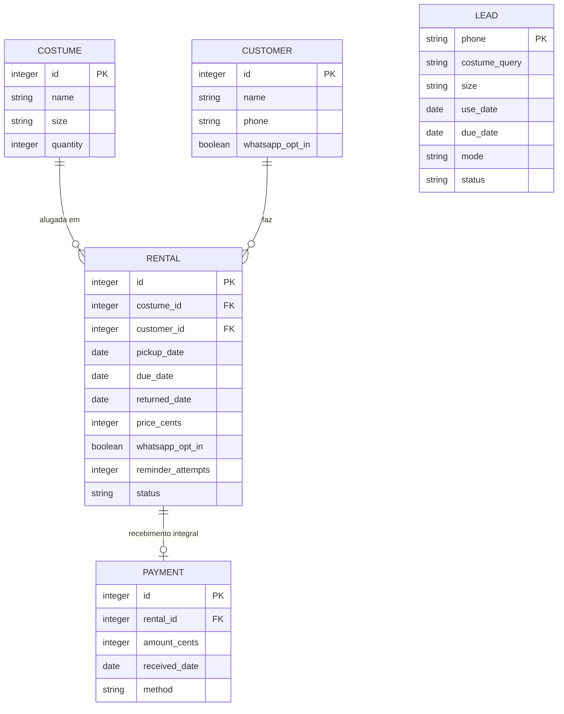
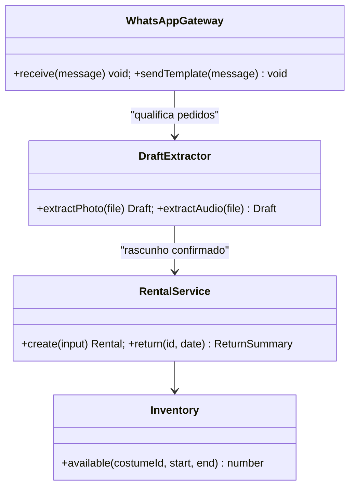

# Blueprint — gestão de fantasias

**Status:** desenvolvimento local. **Data:** 2026-11-19.

## Produto e core loop

A dona registra fantasias e aluguéis; o painel mostra o que retirar, devolver e cobrar; cada movimentação atualiza a disponibilidade. O ganho é reduzir consultas ao papel e entregar ao atendimento uma fonte de dados verificável. A métrica principal é a proporção de pedidos qualificados que chegam à dona com fantasia, tamanho e datas completos. O custo cresce com mensagens e chamadas de IA, não com a quantidade de itens cadastrados.

## Regras invariantes

1. A IA apenas propõe dados; gravações de fichas, áudios e reservas exigem confirmação humana.
2. O estoque disponível é calculado por modelo, tamanho e intervalo de datas; reservas conflitantes não podem superar a quantidade cadastrada.
3. A multa é R$ 10 por dia corrido após a data prevista de devolução. A data prevista não gera multa.
4. Nenhum atendimento promete disponibilidade ou preço sem consulta aos dados confirmados.
5. A cliente pode assumir a conversa; mensagens automáticas param nessa condição.
6. Lembretes por WhatsApp exigem consentimento e modelo aprovado quando enviados fora da janela de 24 horas.

7. Receita recebida só aumenta após confirmação humana. Um aluguel tem no máximo um recebimento integral nesta etapa; centavos são inteiros, a data é a do recebimento e futuras datas são recusadas.

## Dados

Índices: fantasias por nome/tamanho; aluguéis por fantasia/status/datas e por devolução prevista. Leads usam o telefone como chave. Dados de cliente ficam restritos ao painel autenticado.

## Arquitetura e segurança

Aplicação web pequena em Node.js, SQLite persistente e HTML responsivo. Sem infraestrutura de filas no MVP. O servidor guarda sessão, valida entrada e usa consultas parametrizadas. Gemini fica em serviço separado que devolve rascunhos; o banco é a fonte da verdade. O webhook oficial do WhatsApp deve validar assinatura, evitar duplicatas e usar mensagens aprovadas para contato iniciado pela loja. Segredos ficam no ambiente, não no repositório. HTTPS é obrigatório fora do desenvolvimento local. Backup diário do banco antes de operar com dados reais.

## Milestones e testes

1. Domínio e painel local: teste de conflito, multa, validação, autenticação e fluxo de cadastro/devolução.
2. Gemini: testes de extração com respostas simuladas e revisão humana; teste manual com imagens e áudios reais após chave configurada.
3. WhatsApp: testes de assinatura, duplicata, transferência e janela de mensagens; piloto com número de teste antes do número comercial.
4. Lembretes: testes de elegibilidade, consentimento, não duplicação e parada após devolução.

Não haverá publicação, envio ao Git remoto nem uso de dados reais nesta fase de desenvolvimento.
