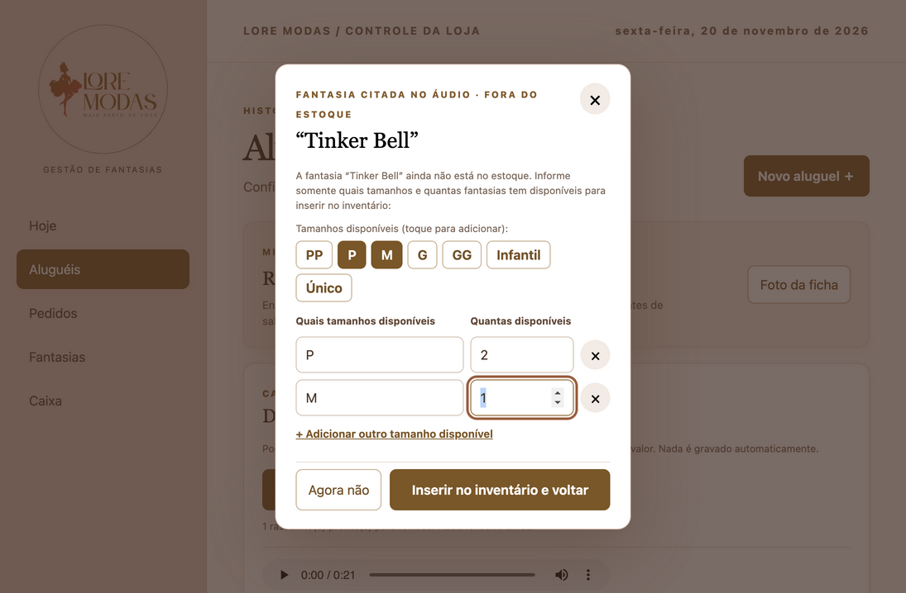
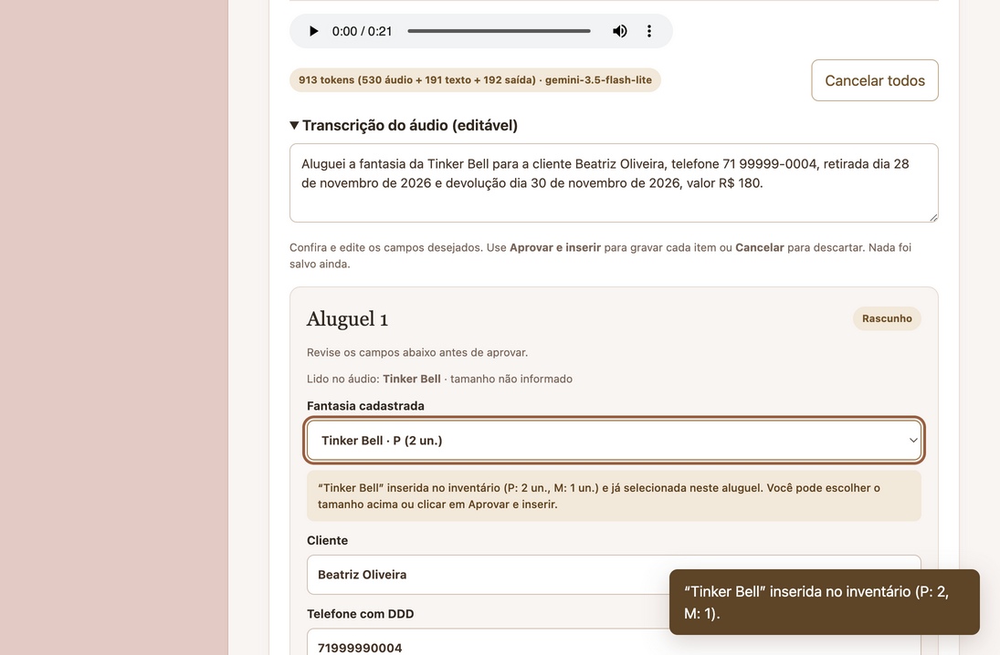

# 🎭 Lore Modas — Sistema de Gestão de Aluguel de Fantasias com IA e WhatsApp

Olá! Este projeto nasceu de um problema bem real de balcão: ajudar a **Lore Modas**, uma loja de aluguel de fantasias, a sair das fichas de papel e anotações manuais para um sistema web leve, rápido e feito sob medida para a rotina corrida de atendimento.

Como desenvolvedor júnior construindo uma solução para uso prático de uma cliente real, meu foco aqui não foi empilhar frameworks pesados, mas sim **entender como a dona da loja trabalha de verdade**, entregar um sistema confiável sem dependências externas desnecessárias e resolver problemas reais de integração com IA, áudio no navegador, banco de dados local e WhatsApp.

---

## 📸 Capturas de tela do projeto

### 1. Tela de acesso privado com a identidade da Lore Modas


### 2. Painel "Hoje" com agenda mensal compacta e controle diário


### 3. Cadastro inteligente por áudio: janela automática para fantasia fora do estoque
Quando a dona cita no áudio uma fantasia que ainda não existe no acervo (como *"Tinker Bell"*), o sistema abre automaticamente esta janelinha já com o nome preenchido, pedindo **apenas os tamanhos e quantidades disponíveis**:


### 4. Revisão do rascunho de áudio com transcrição editável e contador de tokens
Logo após inserir os tamanhos, o foco volta para o rascunho do aluguel já com a fantasia selecionada, transcrição editável, medição real de tokens gastos naquela chamada e botões claros **Cancelar** e **Aprovar e inserir** (nada é gravado automaticamente):


### 5. Controle de Caixa (contratado vs. recebido confirmado)


---

## 💡 Como pensei para criar o projeto

Quando comecei a desenhar o sistema, parti de três princípios simples:

1. **Zero fricção para instalar e manter:** escolhi **Node.js 26 com módulos nativos** (`node:http`, `node:sqlite`, `node:crypto`, `node:test`) e **HTML/CSS/ES Modules puros** no front-end — **0 pacotes no `node_modules`**. Isso deixou o projeto super rápido para subir, fácil de depurar e imune a quebras de dependências.
2. **IA como assistente, nunca gravando no escuro:** no começo pode parecer legal deixar a IA salvar direto no banco, mas em loja física um erro de data ou de valor vira prejuízo. Por isso, **todo áudio ou foto vira primeiro um rascunho editável** na tela, e só entra no banco SQLite quando a dona clica em **Aprovar e inserir**.
3. **Banco local confiável e idempotente:** usando `SQLite` em modo `WAL` (`Write-Ahead Logging`) com recibos de escrita (`write_receipts`), um clique duplo acidental no botão de confirmar nunca duplica um aluguel nem um recebimento no caixa.

---

## 🏪 Adequando o sistema à realidade da cliente (Lore Modas)

Durante os testes práticos com a operação da loja, vários detalhes do dia a dia moldaram diretamente o código:

- **Cadastro por voz para quem atende no balcão:** parar para digitar cliente por cliente em dia de movimento é inviável. O painel permite gravar ou enviar áudios de **30 a 40 segundos com folga** (até 14 MB / 2 minutos), inclusive ditando **vários aluguéis no mesmo áudio**, e o Gemini transcreve e separa cada um em um card editável.
- **Cadastrar fantasias "enquanto aluga" (sem parar a loja para inventário):** percebemos na prática que parar um dia inteiro para cadastrar centenas de fantasias atrasa o uso do sistema. Então criamos o fluxo da **janela pequena automática**: se a dona ditar um aluguel de uma fantasia ainda não cadastrada, o rascunho do cliente fica preservado, abre-se uma janela enxuta com chips rápidos de tamanho (`PP`, `P`, `M`, `G`, `GG`, `Infantil`, `Único`), ela informa quantas peças tem e volta imediatamente para finalizar a locação com a fantasia já selecionada.
- **Áudio guardado localmente se a API oscilar:** se o serviço do Gemini ficar momentaneamente sobrecarregado (`503`) ou cair a conexão, a cliente **não perde o áudio que acabou de gravar**. O arquivo fica salvo em `IndexedDB` logo abaixo do gravador com um player e o botão **Reenviar áudio**, e **só sai de lá quando for enviado com sucesso**.
- **Comprovante imediato de locação no WhatsApp:** assim que o aluguel é confirmado, o sistema já monta a mensagem formatada com todos os dados cadastrados (código da locação, cliente, fantasia, tamanho, retirada, devolução prevista, valor e regra de multa de R$ 10/dia). Se a API oficial da Meta estiver configurada e o cliente deu aceite, dispara automaticamente; caso contrário, já deixa pronto o botão **Abrir aviso no WhatsApp** (`wa.me`) e **Copiar mensagem** em 1 clique.
- **Visual legível e organizado para o balcão:** adaptamos a paleta à identidade da marca **Lore Modas** (rosa suave, dourado escuro e terracota), reduzimos a área do calendário em ~31% para caber junto aos indicadores do dia sem rolagem excessiva e aumentamos o destaque do cabeçalho com a data atual.

---

## 🛠️ Tecnologias utilizadas

| Camada | Tecnologias | Por que escolhi |
| :--- | :--- | :--- |
| **Back-end** | **Node.js 26** (ESM), `node:http`, `node:crypto` | Servidor leve, seguro, sem frameworks pesados e com controle total de rotas, cabeçalhos CSP e rate limiting. |
| **Banco de Dados** | **SQLite nativo (`node:sqlite` / `DatabaseSync`)** | Um único arquivo local (`data/fantasias.sqlite`), modo `WAL`, chaves estrangeiras e índices compostos de disponibilidade. |
| **Front-end** | **HTML5, CSS3, JavaScript (ES Modules)** | Carregamento instantâneo, sem build step, uso de `<dialog>` nativo, `MediaRecorder`, `FileReader` e `IndexedDB`. |
| **Inteligência Artificial** | **Google Gemini API REST** (`gemini-3.5-flash-lite` + fallback) | Compreensão nativa de áudio e foto de ficha em uma única requisição (~2s), com `thinkingLevel: "minimal"` e contador de tokens em tela. |
| **Mensageria** | **Meta WhatsApp Business Cloud API** + deep-link `wa.me` | Validação HMAC-SHA256 de webhooks, qualificação inicial de leads, envio de confirmação de locação e lembrete de atraso. |
| **Testes** | **Node.js Test Runner (`node:test` + `node:assert/strict`)** | 38 testes automatizados cobrindo domínio, API HTTP, banco, áudio em lote, fallback Gemini, WhatsApp e lembretes. |

---

## 🧗 Maiores dificuldades enfrentadas (e como resolvi)

Construir para uso real trouxe problemas que não aparecem em tutoriais simples — e resolver cada um deles foi o maior aprendizado do projeto:

1. **Áudios reais do celular e WhatsApp falhando por causa do MIME Type:**
   - *Problema:* Arquivos `.m4a` (iPhone), `.opus` (WhatsApp) e `.webm;codecs=opus` (Chrome) muitas vezes chegavam com `file.type` vazio, com parâmetros `;codecs=...` ou aliases como `audio/x-m4a`, sendo rejeitados antes mesmo de chegar na IA.
   - *Solução:* Criei a função `resolveMediaMime` em [`src/gemini.js`](src/gemini.js), que normaliza cabeçalhos, inspeciona os **magic bytes** reais do arquivo em Base64 (`RIFF/WAVE`, `OggS`, `ftyp`, `fLaC`, `ID3`, cabeçalho WebM/EBML) e só usa a extensão como último recurso.

2. **Lentidão (>45s), erros `429`/`503` e alto gasto de tokens na API Gemini:**
   - *Problema:* No início, modelos *preview* e `thinkingLevel: "low"` com `responseSchema` rígido estavam gerando centenas de tokens internos de raciocínio, demorando demais ou estourando a cota gratuita (`429`) e caindo em modelos congestionados (`503`).
   - *Solução:* Fiz benchmarks reais por modelo e otimizei toda a camada em [`src/gemini.js`](src/gemini.js):
     - Troquei o padrão para **`gemini-3.5-flash-lite`** com cadeia automática de fallback (`gemini-3.1-flash-lite` → `gemini-3-flash-preview` → etc.) e timeout de `10s` por modelo;
     - Ativei `thinkingLevel: "minimal"` e `temperature: 0`, zerando `thoughtsTokenCount` e derrubando a resposta para **~2 segundos**;
     - Enxuguei o prompt em ~65%, configurei gravação de voz em `32 kbps` e adicionei cache em memória por **SHA-256** (evitando cobrar tokens repetidos em reenvios idênticos);
     - Resultado prático medido: caiu de ~1.630–2.400 tokens para **~913 a 1.186 tokens por áudio**.

3. **Não perder gravações de áudio quando a API oscila:**
   - *Problema:* Quando dava erro `503`, a dona da loja perdia o áudio gravado e precisava falar tudo de novo.
   - *Solução:* Implementei persistência local em **`IndexedDB`** (`lore-modas-saved-audios`) dentro de [`public/audio-import.js`](public/audio-import.js): o áudio fica guardado em um card logo abaixo dos botões (mesmo se a página recarregar) com botão **Reenviar áudio**, e só é apagado após envio bem-sucedido.

4. **Travamento do pedido de microfone em navegadores embutidos:**
   - *Problema:* Em alguns ambientes sem permissão de microfone, `navigator.mediaDevices.getUserMedia` ficava pendente para sempre sem rejeitar a Promise.
   - *Solução:* Criei `getMicrophoneStream(timeoutMs)` combinando pré-verificação via `navigator.permissions.query({ name: 'microphone' })` e `Promise.race` com timeout de 8 segundos, devolvendo uma orientação clara ao usuário.

5. **Conflitos de agenda e idempotência no SQLite:**
   - *Problema:* Garantir que duas reservas da mesma fantasia não estourem o estoque nas mesmas datas (inclusive no mesmo dia de entrega/retirada) e que cliques repetidos não gravem em duplicidade.
   - *Solução:* Separei as regras de calendário em funções puras ([`src/domain.js`](src/domain.js)), validei disponibilidade dentro de transações SQLite e criei a tabela `write_receipts` indexada por `requestId` + *fingerprint* do payload.

---

## 🧩 Classes, módulos e funções interessantes no projeto

Como o projeto usa JavaScript moderno modular (ESM), cada responsabilidade ficou isolada em módulos bem coesos. Alguns dos trechos que mais gostei de construir:

- **`createDatabase` + `DatabaseSync` ([`src/db.js`](src/db.js)):**
  Inicializa o SQLite nativo do Node.js 26 com `PRAGMA journal_mode = WAL`, `foreign_keys = ON`, migração defensiva de colunas novas sem perder dados existentes e tabela `write_receipts` para idempotência das escritas.
- **`extractAudioBatch`, `callGeminiJson` e `resolveMediaMime` ([`src/gemini.js`](src/gemini.js)):**
  Orquestra validação de MIME por *magic bytes*, fallback automático entre modelos Gemini em `429`/`503`/timeout, fallback em duas etapas com `gemini-3.5-transcribe`, cache LRU por `SHA-256` (`AUDIO_RESULT_CACHE`) e extração detalhada de `usageMetadata` (áudio vs. texto vs. saída).
- **`ensureQuickCostumeDialog` e `mountAudioImports` ([`public/audio-import.js`](public/audio-import.js)):**
  Controlador de modal `<dialog>` nativo com **fila de contexto (`queue`)** — se um único áudio citar duas fantasias fora do estoque, ele abre a janelinha para a primeira e, ao salvar, já engata a segunda sem perder nenhum campo do cliente. Também gerencia o gravador `MediaRecorder`, o cofre de reenvio em `IndexedDB` (`persistSavedAudio`, `loadSavedAudios`, `deleteSavedAudio`) e a vinculação inteligente `findMatchingCostume` (mesmo quando o áudio não cita o tamanho).
- **`buildRentalConfirmationMessage` e `sendRentalConfirmation` ([`src/reminders.js`](src/reminders.js)) + `verifySignature` ([`src/whatsapp.js`](src/whatsapp.js)):**
  Monta o comprovante de locação completo, gera link `wa.me` codificado e dispara templates da Meta Cloud API com retentativa limitada (máx. 3 tentativas) e verificação criptográfica `crypto.timingSafeEqual` nos webhooks recebidos.
- **`validRentalDates`, `daysLate` e `intervalsOverlap` ([`src/domain.js`](src/domain.js)):**
  Núcleo de regras puras de negócio (datas ISO sem bug de fuso horário, cálculo de multa de R$ 10/dia corrido e interseção inclusiva de períodos).
- **`mountCalendar` ([`public/calendar.js`](public/calendar.js)) e `mountCash` ([`public/cash.js`](public/cash.js)):**
  Componentes leves em vanilla JS. O calendário usa um contador `generation` para cancelar respostas antigas caso a usuária clique rápido entre vários meses (evitando *race conditions* na UI).
- **`recordGeminiUsage` ([`src/hermes-usage.js`](src/hermes-usage.js)):**
  Integração opcional que registra o histórico local de tokens Gemini (`input_tokens`, `output_tokens`, `reasoning_tokens`) no formato SQLite lido por ferramentas de acompanhamento como o Codenotch.

---

## 📁 Estrutura do projeto

```text
fantasia-mvp/
├── src/
│   ├── server.js          # Servidor HTTP, sessões com cookie HttpOnly, rotas REST e webhook
│   ├── db.js              # Schema SQLite (WAL), índices e migrações automáticas
│   ├── domain.js          # Regras puras de datas, sobreposição e cálculo de multa
│   ├── gemini.js          # Integração Gemini (áudio/foto), magic bytes, fallback e cache
│   ├── whatsapp.js        # Validação HMAC-SHA256 da Meta e qualificação de leads
│   ├── reminders.js       # Comprovante imediato de locação e lembrete de atraso
│   └── hermes-usage.js    # Registro local opcional de consumo de tokens
├── public/
│   ├── index.html         # Estrutura semântica do painel e modais nativos
│   ├── styles.css         # Identidade visual Lore Modas (responsiva para desktop e celular)
│   ├── app.js             # Estado da aplicação, rotas por hash, login e importação de ficha
│   ├── audio-import.js    # Gravação, upload, IndexedDB de reenvio e janela rápida de estoque
│   ├── calendar.js        # Calendário mensal interativo com proteção contra race conditions
│   └── cash.js            # Controle de Caixa (contratado x recebido confirmado)
├── test/                  # 38 testes automatizados (API, áudio, domínio, Gemini, WhatsApp)
├── docs/
│   ├── screenshots/       # Capturas de tela da documentação (dados 100% fictícios)
│   └── caixa-proximas-etapas.md
├── .env.example           # Modelo de variáveis de ambiente (sem segredos)
└── package.json           # Scripts nativos (start, dev, test, check)
```

---

## 🚀 Como rodar localmente

Requer **Node.js 26+** (sem precisar rodar `npm install`).

1. Copie o arquivo de exemplo de ambiente e defina uma senha de acesso com pelo menos 12 caracteres:
   ```bash
   cp .env.example .env
   ```
   Edite o `.env` configurando `ADMIN_PASSWORD` e, opcionalmente, `GEMINI_API_KEY` (para transcrição de áudio e leitura de fotos) e as credenciais da Meta (para envio automático via WhatsApp Cloud API).

2. Inicie o servidor:
   ```bash
   npm start
   ```

3. Acesse no navegador:
   ```text
   http://127.0.0.1:3000
   ```

### Rodando os testes e validações

```bash
npm run check   # Valida sintaxe de todos os arquivos JS (back-end e front-end)
npm test        # Executa os 38 testes automatizados com node:test
```

---

## 🔒 Segurança e observações de produção

- O arquivo `.env` e a pasta `data/` (banco SQLite com dados reais) ficam fora do controle de versão via [`.gitignore`](.gitignore).
- As capturas de tela deste `README.md` foram geradas em um banco isolado com **dados 100% fictícios**.
- Em ambiente de produção real, recomenda-se rodar atrás de proxy reverso com HTTPS (`TRUST_LOCAL_PROXY=1`), disco persistente com backup automático do SQLite e chave Gemini no plano pago (*Pay-as-you-go / Tier 1*) para garantir privacidade de dados de clientes e maior estabilidade em horários de pico.
